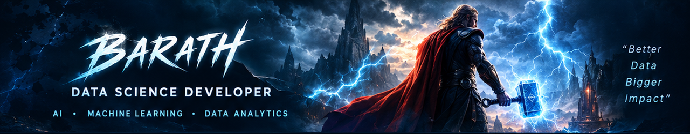

<div align="center">

<!-- Thor-Inspired Profile Header Banner -->
<a href="https://github.com/barathcbe06-gif">
  <picture>
    <source media="(prefers-color-scheme: dark)" srcset="./assets/thor-banner.png">
    
  </picture>
</a>

# ⚡ BARATH — THE THUNDERVERSE

### `M.Sc. Data Science Scholar` • `AI/ML Engineer` • `Algorithmic Intelligence`

[](https://barath-thunderverse.vercel.app)
[](https://github.com/barathcbe06-gif)
[](https://www.linkedin.com/in/barath-datascience)
[](mailto:barath.datascience@outlook.com)

---

</div>

## 🌌 The Genesis & Mission

> *"Transforming noisy, complex data streams into decisive strategic intelligence through mathematical rigor, computational efficiency, and production-grade architectures."*

I am **Barath**, an **M.Sc. Data Science scholar** driven by the mission to turn raw telemetry into transparent, predictive intelligence. My academic training in multivariate calculus, linear algebra, and probabilistic inference shapes my approach to Artificial Intelligence and Machine Learning.

Rather than treating models as opaque black-box heuristics, I focus on algorithmic transparency, numerical stability, and robust data pipeline architecture. From orchestrating high-throughput analytical queries with **Python** and **SQL** to engineering deep representation learning models in **PyTorch**, I build systems engineered for real-world reliability.

- 🎓 **Academic Degree:** M.Sc. in Data Science
- ⚡ **Core Arsenal:** Python • SQL • Data Science • AI/ML Systems
- 🔭 **Current Focus:** Multivariate temporal anomaly detection, high-throughput streaming pipelines, and AST-validated SQL synthesis
- 💼 **Status:** Open for Data Science, Machine Learning Engineering, and AI Research opportunities
- 📍 **Location:** Remote Friendly / Global

---

## ⚡ Technical Weaponry

<div align="center">

| Domain | Arsenal & Tooling |
| :--- | :--- |
| **Foundations & Core** | `Python (NumPy, SciPy)` • `SQL (PostgreSQL, DuckDB)` • `Linear Algebra` • `Probability Theory` |
| **Machine Learning & AI** | `PyTorch` • `Scikit-Learn` • `XGBoost` • `Computer Vision (OpenCV)` • `Transformers (HuggingFace)` |
| **Data Engineering** | `Polars` • `Pandas` • `DuckDB` • `Columnar Storage` • `ETL Pipelines` • `Vectorization` |
| **MLOps & Infrastructure** | `FastAPI` • `Docker` • `ONNX Runtime` • `MLflow` • `Git CI/CD` • `Streamlit` |

</div>

<br/>

<div align="center">

```
┌────────────────────────────────────────────────────────────────────────────────────────┐
│                              DATA & INFERENCE ARCHITECTURE                             │
│                                                                                        │
│   [ Raw Telemetry ] ──────> [ Analytical Engine ] ──────> [ Neural Tensor Core ]       │
│   High-Volume Streams       Polars / DuckDB Aggs          PyTorch / ONNX Runtime       │
│                                                                   │                    │
│                                                                   ▼                    │
│   [ Production Alerting ] <── [ Asynchronous API ] <────── [ EVT Thresholding ]       │
│   Dashboards / Alerts          FastAPI Microservice          Extreme Value Validation  │
└────────────────────────────────────────────────────────────────────────────────────────┘
```

</div>

---

## 🛡️ Featured Projects & Systems

### 1. 🌩️ [NeuroStorm — High-Throughput Time-Series Anomaly Detector](https://github.com/barathcbe06-gif/neuro-storm-anomaly-detection)
> **Python • PyTorch • FastAPI • Docker • DuckDB**
- Engineered an unsupervised deep learning framework combining **Temporal Convolutional Networks (TCN)** and **Variational Autoencoders (VAE)** for multivariate sensor stream telemetry.
- Formulated dynamic thresholding based on **Extreme Value Theory (EVT)**, reducing false-positive alerts by **38%**.
- Benchmarked at **50,000+ data points/sec** with sub-15ms inference latency, containerized with Docker.

### 2. ⚡ [SQL-Nexus — Text-to-Optimized-SQL Analytical Synthesizer](https://github.com/barathcbe06-gif/sql-nexus-synthesizer)
> **Python • SQL • PostgreSQL • DuckDB • LangChain • Streamlit**
- Natural language query translator featuring **Abstract Syntax Tree (AST)** grammar parsing to guarantee valid dialect execution and eliminate SQL injection vulnerabilities.
- Automated query cost analyzer providing index recommendations based on PostgreSQL `EXPLAIN ANALYZE` telemetry.
- Evaluated with **91.5% zero-shot accuracy** across multi-table schema benchmarks.

### 3. 👁️ [OmniVision — Real-Time Industrial Defect Segmentation](https://github.com/barathcbe06-gif/omnivision-defect-segmentation)
> **Python • PyTorch • OpenCV • ONNX Runtime • Docker**
- Developed a lightweight MobileNetV3-UNet segmentation architecture deployed for real-time manufacturing defect inspection.
- Model quantized with **ONNX Runtime** achieving **45 FPS** on resource-constrained edge hardware with an **87.6% Mean IoU**.
- Overcame severe class imbalance using targeted OpenCV data augmentation pipelines.

### 4. ⚙️ [DataForge — Scalable Streaming Analytics & Metric Engine](https://github.com/barathcbe06-gif/dataforge-streaming-etl)
> **Python • Polars • DuckDB • Streamlit • Plotly**
- Built an in-memory streaming pipeline utilizing Polars lazy evaluation and DuckDB columnar execution over 10M+ transactional rows in seconds.
- Achieved **6.8x memory reduction** compared to traditional Pandas batch workflows.
- Features automated schema drift detection and interactive cohort dashboards.

### 5. 🌌 [Barath Thunderverse — 3D Developer Portfolio](https://github.com/barathcbe06-gif/BARATH-THUNDERVERSE)
> **React • TypeScript • Three.js / React Three Fiber • Tailwind CSS • Vite**
- Interactive 3D portfolio featuring procedural lightning atmosphere shaders, camera rigs, and Thor-inspired aesthetic.
- 🌐 **Live Deployment:** [barath-thunderverse.vercel.app](https://barath-thunderverse.vercel.app)

---

## 📊 GitHub Analytics & Activity

<div align="center">

<!-- GitHub Stats Card -->

<!-- Top Languages Card -->


<br/>

<!-- GitHub Streak Stats -->


</div>

---

## ⚡ Direct Transmissions & Networks

- 🌐 **Interactive 3D Portfolio:** [barath-thunderverse.vercel.app](https://barath-thunderverse.vercel.app)
- 💼 **LinkedIn Profile:** [linkedin.com/in/barath-datascience](https://www.linkedin.com/in/barath-datascience)
- 📬 **Direct Inquiries:** [barath.datascience@outlook.com](mailto:barath.datascience@outlook.com)
- 🐙 **GitHub Profile:** [@barathcbe06-gif](https://github.com/barathcbe06-gif)

---

<div align="center">

<sub>Forged in the storm of mathematical curiosity and computational craft. © Barath.</sub>

</div>
